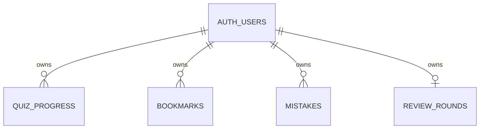

# Thiết kế dữ liệu Supabase cho StudyHub

Trạng thái: **bản thiết kế để review, chưa triển khai**. Đối chiếu với code ngày 13/10/2026. Bản SQL tương ứng nằm ở `docs/supabase/schema-draft.sql`; chưa chạy trên PostgreSQL. Quy tắc làm việc theo từng task vẫn ở `AGENTS.md`.

## 1. Dữ liệu hiện có trên trình duyệt

Mọi key dưới đây thuộc một browser origin, chưa gắn tài khoản và chưa có thời điểm sửa đáng tin cậy. `lib/storage.ts` chỉ đọc/ghi chuỗi; validation nằm ở từng module. Không phát hiện thêm dữ liệu ứng dụng trong cookie, IndexedDB, `sessionStorage` hoặc key localStorage khác qua source hiện tại.

| Nhóm và key | Giá trị version 1, chủ sở hữu hiện tại | Ghi, xóa, kiểm tra và khôi phục | Đưa lên cloud? |
| --- | --- | --- | --- |
| Quiz thường: `ju-study-hub:quiz-progress:<subjectId>:<chapterId>` | Một object `{version:1,currentQuestionId,answers}` cho mỗi chapter; `answers[questionId]={optionId,isSubmitted}` gồm nháp và đã chấm. Thuộc origin, không có user ID. | `useQuizProgress` đọc sau mount; `restoreProgress` chỉ nhận câu/option đang hợp lệ. Chọn, chấm, đổi câu ghi toàn snapshot; reset hoặc trạng thái rỗng xóa key. Lỗi đọc/ghi giữ state trong RAM nhưng không có hàng đợi ghi bền. | Có, mỗi user/chapter một row. |
| Bookmark: `ju-study-hub:bookmarks:v1` | `{version:1,items:[{subjectId,chapterId,questionId}]}`. | `parseBookmarks` bỏ ref hỏng, loại trùng; ref câu đã bỏ vẫn lưu nhưng không mở được. Thêm/bỏ lưu cập nhật danh sách. Khi storage lỗi, `lastReadable` và `pending` giữ thay đổi trong phiên rồi ghép với bản mới nhất trước khi ghi lại. | Có, một row cho mỗi bộ ba ID, kể cả ref chưa còn trong catalog. |
| Kho câu sai: `ju-study-hub:mistakes:v1` | Cùng dạng ref version 1 như bookmark. | Sai ở quiz thường thêm; đúng ở quiz thường không xóa; đúng trong Review xóa. `fallback` và `pending` hỗ trợ đọc/ghi lỗi, không bền qua reload. `ReviewMistakes` hiện đối chiếu catalog rồi gọi `saveMistakes(current)` khi mở trang, có thể loại ref tới câu đã bị bỏ khỏi bộ hiện hành. Cần chụp raw trước bước này khi import; không coi việc lọc UI là lệnh xóa cloud. | Có, một row cho mỗi bộ ba ID. |
| Snapshot lượt Review: `ju-study-hub:review-round:v1` | `{version:1,scope:{subjectId,chapterId},items:[ref]}`. Scope có thể null; bản cũ thiếu scope hiểu là tất cả. | `parseReviewRound` kiểm tra ref/scope; `createReviewRound` lọc theo catalog nhưng giữ thứ tự snapshot. Lượt mới thay snapshot sau xác nhận nếu lượt cũ dở. Khi storage lỗi, lượt mới chỉ còn trong state của trang. | Có, cùng row với tiến độ Review để thay lượt nguyên tử. |
| Tiến độ Review: `ju-study-hub:review-progress:v1` | Cùng cấu trúc tiến độ quiz; question ID là `JSON.stringify([subjectId,chapterId,questionId])`. | Khôi phục theo snapshot lượt hiện tại và option hợp lệ. Bắt đầu lượt mới xóa key; Review reset chỉ tác động key này. Hai thao tác xóa tiến độ/ghi snapshot hiện là hai lệnh localStorage riêng, nên lỗi giữa chừng có thể để lại cặp không khớp. | Có, là `progress` trong row Review. |

Không có dữ liệu tài khoản, mật khẩu, lịch sử lượt hoàn thành hay nội dung câu hỏi trong storage hiện tại. Quiz thường độc lập với Review; bookmark và kho câu sai chỉ lưu ID. Dữ liệu câu hỏi tiếp tục nằm trong `data/` của repository, không tạo bảng câu hỏi ở giai đoạn này.

## 2. Bốn bảng và quan hệ

`auth.users.id` là nguồn định danh duy nhất; mọi row của người học có `user_id uuid` trỏ tới nó. Xóa một Auth user sẽ cascade xóa dữ liệu của họ. Các bảng không có khóa ngoại tới câu hỏi vì catalog TypeScript không nằm trong database và ref cũ cần được bảo toàn.

| Bảng | Khóa và cột chính | Vì sao chọn cấu trúc này |
| --- | --- | --- |
| `quiz_progress` | PK `(user_id,subject_id,chapter_id)`; `current_question_id text`, `answers jsonb`, `format_version smallint`, `reset_at timestamptz`, `revision bigint`, `last_operation_id uuid`, `created_at/updated_at timestamptz`. | Vị trí, nháp và câu đã chấm tạo một snapshot chapter; JSONB giữ map đáp án mà không thêm bảng mỗi câu. `reset_at` đánh dấu reset thay vì xóa row. |
| `bookmarks` | PK `(user_id,subject_id,chapter_id,question_id)`; `is_present boolean` cùng revision, operation ID, timestamps. | Một thay đổi của một bookmark không ghi đè bookmark khác. `is_present=false` là tombstone để thiết bị cũ không nhập lại. |
| `mistakes` | PK bộ bốn ID như bookmark; `is_present boolean` và metadata đồng bộ tương tự. | Giữ đúng bộ ba định danh câu, nhưng quy tắc thêm/xóa khác bookmark. Một câu đã giải đúng trong Review có tombstone riêng. |
| `review_rounds` | PK `user_id` (một snapshot lượt hiện hành mỗi user); `round_id uuid`, scope bằng hai cột text nullable, `items jsonb` có thứ tự, `progress jsonb`, `format_version`, `cleared_at`, revision, operation ID, timestamps. | Snapshot phải giữ thứ tự kể cả khi mistakes thay đổi; progress và lượt mới cần cập nhật nguyên tử trong một row. `round_id` chặn ghi muộn từ lượt cũ. |

`answers` và `progress` là JSONB vì chúng là snapshot có kích thước nhỏ theo chapter/lượt và không cần query từng câu trên server. `items` Review là JSONB array để giữ thứ tự. Các ID dùng để tìm, gộp và bảo vệ tombstone là cột quan hệ và PK. `format_version` của row cloud là **phiên bản định dạng cloud**, không phải version 1 của localStorage hay `Chapter.revision`.

Cloud `answers` format 1: `{[questionId]:{optionId:string,isSubmitted:boolean,contentRevision:number|null}}`. `progress` Review có `{version:1,currentQuestionId:string|null,answers:{...}}`, mỗi answer cũng có `contentRevision`. Chuyển từ local version 1 sẽ gắn `contentRevision:null` vì dữ liệu cũ không ghi revision lúc trả lời; khi ghi trở lại local version 1 phải bỏ trường cloud bổ sung. PostgreSQL `CHECK` xác nhận JSONB là object/array và version/scope cơ bản; app phải xác thực ID, option, answer shape và catalog trước khi hiển thị hoặc import. PostgreSQL bảo vệ PK, FK, kiểu dữ liệu, tombstone và ownership. Không dùng `updated_at` từ client làm trọng tài xung đột.

Với `review_rounds`, row đang hoạt động có `cleared_at = null`, `items` không rỗng và `round_id` UUID định danh đúng một lượt. `items` phải là danh sách ref có thứ tự, không trùng bộ ba ID; mỗi ref phải có ba ID chuỗi không rỗng. `progress.currentQuestionId` là ID tuple của một item trong lượt hoặc `null`; mọi key trong `progress.answers` phải thuộc lượt đó, có option hợp lệ và answer đúng shape. Khi xóa lượt, giữ row tombstone với `cleared_at` khác null, `items=[]`, cursor null và `answers={}`. Bắt đầu lượt sau phải thay `round_id`, scope, items, progress rỗng và đặt `cleared_at=null` trong **một** update có điều kiện. PostgreSQL chỉ kiểm tra UUID/NULL, kiểu JSONB và hình dạng trạng thái cleared; kiểm tra từng ref, catalog, tính duy nhất, quan hệ giữa cursor/answer và items là trách nhiệm ứng dụng. `cleared_at` chỉ là dấu tombstone, không dùng thời gian client để phân xử lượt mới/cũ; không thêm trigger validation JSON sâu.

Các PK bắt đầu bằng `user_id`, nên đã có B-tree index cho lọc theo owner và truy vấn theo subject/chapter. Không thêm index phụ trước khi có query thực tế. Trigger phía database đặt timestamps và tăng `revision`; mỗi thao tác logic mới dùng `last_operation_id` UUID mới, còn retry giữ UUID cũ. `revision` là số lần đổi row để kiểm tra ghi có điều kiện, không liên quan đến nội dung chapter.

## 3. ID ổn định và thay đổi bộ câu hỏi

Registry hiện dùng subject ID `blockchain`, `database`; chapter ID là key trong `data/<subject>/index.ts`; question ID và option ID nằm trong `Question`. `optionId` như `a` đến `d` chỉ có ý nghĩa trong **một câu**. Dùng đủ `(subject_id,chapter_id,question_id)` khi lưu bookmark/mistake; không dùng vị trí mảng, tiêu đề hay text làm khóa. Chapter hiện có `revision` từ 0 đến 2. Các số này không chứng minh đầy đủ lịch sử chỉnh sửa trước đây.

- Đổi tên chapter hoặc đổi thứ tự câu mà giữ ID: dữ liệu cũ vẫn nhận diện được; cursor lưu theo question ID. Không cần migration dữ liệu.
- Bỏ câu: giữ row và answer lịch sử; UI có thể ghi “không còn trong bộ hiện tại”, không xóa cloud chỉ vì catalog không tìm thấy. Nếu nhập lại cùng ID với nghĩa khác, đó là lỗi định danh; cần ID mới hoặc migration có chủ đích.
- Đổi option ID, ý nghĩa option hoặc đáp án đúng: tăng `Chapter.revision` trước khi phát hành. Answer đã chấm ở revision cũ vẫn là bản ghi lựa chọn lịch sử, không tự coi là đúng/sai theo đáp án mới. UI tương lai phải đánh dấu cần ôn lại hoặc hỏi trước khi làm lại; đừng âm thầm chấm lại/xóa.
- Answer nhập từ local cũ có `contentRevision:null`: chỉ biết ID/option hiện còn hợp lệ, không biết phiên bản lúc trả lời. Giữ nguyên, gắn nhãn lịch sử chưa xác minh khi quy tắc chấm thay đổi. Answer mới lưu revision tại thời điểm chọn/chấm theo từng câu, để không nâng revision của các answer cũ khi người dùng chỉ sửa một câu.
- Chỉ đổi giải thích, nguồn hoặc nhãn hiển thị mà không đổi nghĩa câu/option: không cần migration answer. Nếu đổi ID, tách/gộp chapter hoặc đổi nghĩa ID, phải có mapping migration được review riêng; không dùng `format_version` để biểu diễn thay đổi nội dung.

## 4. Nhập local lên cloud ở lần đăng nhập đầu

1. Trước khi thay ngữ cảnh UI, đọc **raw** năm nhóm key và lưu snapshot tạm để báo số bản ghi. Parse theo hàm hiện có, đối chiếu registry và giữ nguyên raw kể cả khi hỏng; không mở `/review` trước khi chụp mistakes vì trang đó có thể chuẩn hóa danh sách. OAuth redirect sẽ làm mất state RAM: lưu bản staging bền hoặc đọc lại raw ngay sau callback trước khi mount màn hình có ghi storage. Nếu raw khác bản xem trước, yêu cầu xem lại thay vì nhập snapshot cũ.
2. Đăng nhập Google qua Supabase Auth; lấy `user.id` từ session đã xác minh. Key local cũ không có owner, nên hiển thị rõ dữ liệu trên thiết bị sẽ gắn với tài khoản nào và xin lựa chọn trước khi nhập, đặc biệt trên máy dùng chung.
3. Đọc bốn bảng cloud của chính user, **gồm row `is_present=false` và `reset_at/cleared_at`**. Không coi tombstone là row trống. So sánh theo khóa đầy đủ; không suy ra local mới hơn vì local v1 không có timestamp/revision.
4. Tạo bản xem trước: bản hợp lệ chưa có trên cloud có thể nhập; bản giống nhau không cần ghi; bản khác nhau hoặc bị loại khi validation cần hiện lý do. Bookmark/mistake local chỉ gồm phần tử có mặt, nên việc **vắng** trong local không phải lệnh xóa một phần tử cloud.
5. Với quiz cùng chapter có hai snapshot khác nhau, **không tự gộp**, kể cả khi answer thuộc những câu khác nhau. Giữ cả hai bản trong preview và yêu cầu người dùng chọn giữ cloud hay thay bằng bản local/làm lại; nêu rõ cursor, nháp, câu đã chấm và reset tombstone sẽ bị ảnh hưởng. Với Review cùng user có hai lượt khác nhau, cũng không gộp; cho chọn giữ cloud hay thay bằng lượt trên thiết bị, và xác nhận mất lượt dở nào. Không suy ra bản mới hơn từ timestamp local hoặc `contentRevision:null`.
6. Ghi các row mới bằng insert-if-absent; row đã tồn tại luôn chuyển sang bước so sánh, **không upsert ghi đè**. Mỗi lần ghi có operation UUID cố định cho retry. Sau mỗi response, đọc lại row hoặc dùng `RETURNING` để xác nhận server đã lưu đúng dữ liệu. Với lựa chọn ghi đè, dùng `revision` đã đọc để cập nhật có điều kiện; 0 row nghĩa là có thay đổi đồng thời và phải so sánh lại.
7. Nếu mạng lỗi hoặc xác nhận thất bại, giữ toàn bộ local raw và trạng thái pending. Lần đăng nhập sau lặp lại an toàn: PK + tombstone ngăn duplicate và hồi sinh bản đã xóa; marker nhập theo user trên thiết bị chỉ được đánh dấu sau xác minh. Người dùng có nút thử lại, không cần xóa local. Không tự nhập cùng bộ local cũ sang một user khác khi đổi tài khoản.

Tiến độ Review chỉ được nhập nếu có snapshot lượt Review hợp lệ; progress mồ côi được giữ local và báo để xem xét. Local record sai format hoặc ID/option đã bỏ không được âm thầm chuyển thành dữ liệu “sạch”: báo phần đã bỏ qua, giữ raw để người dùng quyết định. Answer legacy có `contentRevision:null` vẫn được giữ như lịch sử chưa xác minh; khi nội dung đổi, không âm thầm chấm lại theo đáp án hiện hành. Không tự nhập dữ liệu local origin cũ vào tài khoản khác sau khi đổi user. Không xóa local ngay cả sau khi cloud xác nhận; dọn local, nếu có, là một lựa chọn riêng sau khi tính đến đăng xuất và máy dùng chung.

## 5. Đồng bộ sau khi đăng nhập

Thiết kế tương lai giữ UI local-first: thao tác quiz cập nhật state ngay; cache theo `user.id` và một outbox bền riêng cho từng thao tác ghi ý định (`operation_id`, entity key, desired state, base revision/round ID). Đây là **key/cache mới ở task sau**, không thay schema local v1 trong Task 4. Mỗi op lưu riêng giúp hai tab ít ghi đè cùng một mảng outbox; `storage` event hoặc `BroadcastChannel` chỉ đánh thức đồng bộ, không quyết định thứ tự. Nếu browser storage bị chặn, thao tác chỉ sống trong RAM và UI phải báo không thể bảo đảm đồng bộ sau reload.

Worker đồng bộ gửi insert-if-absent hoặc **một UPDATE có bộ lọc** theo PK và `revision = expected_revision`; với Review progress còn lọc `round_id = expected_round_id` và `cleared_at IS NULL`. Kiểm tra lỗi và số row trả về (`RETURNING`/`.select()`): đúng một row mới xác nhận thành công; 0 row phải đọc lại, không retry mù. Trigger tăng revision nhưng **không kiểm tra expected revision**. RLS chỉ giới hạn owner; nó không thực thi optimistic concurrency. Với grant `UPDATE` trực tiếp, một client authenticated có thể bỏ bộ lọc revision, dùng operation ID mới và ghi đè dữ liệu mới hơn của chính mình. CAS ở MVP vì thế là hợp đồng của ứng dụng và test client, không phải bất biến được database bảo đảm cho mọi client.

Nếu 0 row hoặc response mất, đọc lại: `last_operation_id` trùng nghĩa là op đã thành công, không gửi lại; nếu ID khác và snapshot khác thì đánh dấu conflict, giữ pending và hỏi người dùng. ID khác nhưng snapshot giống chỉ có thể đánh dấu đã hội tụ sau khi so sánh đầy đủ các field liên quan, kể cả `reset_at`, `round_id` và tombstone; không diễn giải việc đó là op cũ đã chạy. Duplicate operation ID cho cùng một ý định phải tái sử dụng ID cũ khi retry; trigger từ chối UPDATE có ID bằng row hiện tại. Điều này giúp nhận diện response mất, nhưng không phải nhật ký idempotency đầy đủ: ID cũ có thể bị thay bởi op mới hơn trước khi retry. Khi đó phải dừng và so sánh lại, không ghi đè. Xóa outbox op chỉ sau khi xác nhận server. Không dùng đồng hồ thiết bị để quyết định bản nào mới. Sync khi online/focus/login, có retry chậm dần; Supabase Auth session phải còn hợp lệ trước mỗi lần gửi.

Một RPC `UPDATE ... WHERE revision = expected_revision` chạy ở database có thể bắt buộc client cung cấp revision, từ chối thiếu/sai revision và trả trạng thái conflict trong cùng transaction; quyền `UPDATE` trực tiếp của browser khi đó phải được thu hồi để không có đường vòng. RPC phù hợp khi cần bảo đảm CAS trước client cũ/không tin cậy, khi lỗi thiếu bộ lọc xuất hiện, hoặc khi một thao tác phải nguyên tử qua nhiều row. RPC cần thiết **trước khi tuyên bố database bảo đảm chống lost update** hoặc mở API ghi cho client ngoài app. MVP chưa có RPC; nếu vẫn cấp direct UPDATE thì phải ghi rõ giới hạn này trong đánh giá rủi ro và test hành vi thực tế, không suy ra từ RLS.

| Trường hợp | Quy tắc |
| --- | --- |
| Hai chapter khác nhau, hai bookmark/mistake khác ID | Row độc lập; đồng bộ song song và hợp nhất theo PK. |
| Cùng chapter, khác câu | Hai snapshot khác nhau vẫn là conflict; giữ cả hai, cho người dùng chọn, không tự gộp answer hoặc cursor. |
| Cùng câu khác đáp án, draft với submitted, hoặc content revision khác | Không dùng last-write-wins; giữ cả hai bản để người dùng chọn hoặc làm lại câu. Không tự hạ answer đã chấm thành nháp. |
| Reset quiz | Ghi `reset_at` khác null, `current_question_id=null`, `answers={}` bằng CAS; giữ row tombstone. Thiết bị cũ dùng revision trước reset bị CAS trả 0 row, phải đọc tombstone và hỏi trước khi xử lý pending cũ; không tự rebase snapshot trước reset. Bắt đầu attempt mới dùng revision sau reset, operation ID mới, đặt `reset_at=null` cùng cursor/answer mới trong một UPDATE; SQL CHECK chỉ cho answers khác rỗng khi reset marker đã được xóa. Stale device cũng bị chặn khi cập nhật sau attempt mới nhờ revision/operation order, với điều kiện mọi writer tuân CAS. |
| Bỏ bookmark / giải đúng trong Review | Đổi `is_present=false` bằng CAS; tombstone ngăn import cũ hồi sinh. Sai mới ở quiz thường có thể tạo operation `is_present=true` sau tombstone nếu dựa trên revision mới. |
| Bắt đầu, thay hoặc xóa Review | Bắt đầu/thay dùng một CAS cập nhật `round_id` mới, scope, items, progress rỗng và `cleared_at=null`. Xóa lượt ghi tombstone cleared cùng items/progress rỗng bằng CAS. Progress chỉ được ghi khi revision, `round_id` và trạng thái active đều còn khớp; tab có lượt cũ phải dừng, không thay thế lượt mới. Cần xác nhận khi thay lượt đang dở, như UI hiện tại. |
| Logout / đổi tài khoản | Cảnh báo trước logout nếu có pending; không âm thầm bỏ pending. Ngừng worker, chờ/hủy request của user cũ và chặn response muộn đi vào cache user mới. Cache theo user ID: xóa phần đã đồng bộ an toàn khi logout, giữ pending bền theo đúng user cũ để xử lý khi chính user đó đăng nhập lại. Legacy origin chỉ là nguồn nhập có xác nhận, không tự nhập vào user khác. |

Tombstone và CAS do app tuân thủ là phần tối thiểu để tránh “xóa rồi xuất hiện lại” ở MVP. `last_operation_id` hỗ trợ xác nhận response thất lạc khi nó vẫn là ID gần nhất trên row; không cần bảng event log trong thiết kế hiện tại. Server `updated_at` dùng để hiển thị/chẩn đoán, không làm last-write-wins. Outbox và cache không phải Auth credential; tuyệt đối không chuyển session hay token giữa tài khoản bằng cách sao chép key ứng dụng.

## 6. Quyền truy cập và kiểm chứng RLS

SQL draft bật RLS trên cả bốn bảng, thu hồi grant của `anon`, chỉ cấp `SELECT`, `INSERT`, `UPDATE` cho `authenticated`. Mỗi thao tác có policy owner theo `(select auth.uid()) = user_id`; `UPDATE` kiểm tra cả row cũ (`USING`) và row mới (`WITH CHECK`). Không cấp `DELETE` cho browser vì xóa/reset dùng tombstone. `user_id` mặc định từ session; dù client gửi ID tùy ý, RLS không cho gán row của user khác. Không thêm bảng password/profile và không để service-role/secret key trong browser. `TO authenticated` cũng áp dụng cho danh tính anonymous **được tạo bởi Supabase Auth**; bản thiết kế giả định tính năng anonymous Auth không bật khi chỉ dùng Google. Nếu bật, cần policy theo claim và test bổ sung. [Supabase RLS](https://supabase.com/docs/guides/database/postgres/row-level-security) phân biệt hai kiểu anonymous, grant với policy; [Supabase Auth user data](https://supabase.com/docs/guides/auth/managing-user-data) khuyến nghị FK tới PK `auth.users.id`.

Khi có project thử: áp SQL ở môi trường disposable, tạo hai Auth user A/B độc lập bằng Supabase Auth test setup trước khi có Google UI; gọi API với access token riêng của A và B, không dùng service-role cho request cần test RLS. Với JWT A thử đọc/thêm/sửa row A, đọc/sửa row B, giả `user_id=B`, và `DELETE`; lặp chiều ngược với B. Thử `anon` trên cả bốn thao tác, bao gồm trường hợp không có grant. Kiểm tra trigger tăng revision/timestamps, PK trùng, check JSON/scope và trạng thái cleared. Tách test CAS thật khỏi test RLS: dùng **hai client connection của cùng một user** cùng đọc revision N, một client ghi thành N+1, client kia gửi UPDATE với N phải nhận 0 row và giữ pending; gửi UPDATE thiếu bộ lọc revision bằng direct grant hiện tại để xác nhận rủi ro ghi đè đã nêu, không coi RLS pass là CAS pass. Kiểm tra thêm duplicate operation ID, response mất rồi đọc lại, reset → attempt mới → thiết bị stale đồng bộ, và Review round cũ gửi progress sau khi round mới bắt đầu/round bị xóa. Chỉ khi các test này qua mới đưa draft thành migration. Supabase cảnh báo rằng policy không tự thu hồi grant cũ và tài khoản service-role bỏ qua RLS. [Supabase RLS](https://supabase.com/docs/guides/database/postgres/row-level-security), [API keys](https://supabase.com/docs/guides/getting-started/api-keys).

| Ca kiểm tra concurrency/lifecycle | Kết quả cần thấy |
| --- | --- |
| Hai client của cùng user cùng đọc revision N; client 1 ghi với expected N, client 2 ghi với expected N cũ | Client 1 cập nhật một row lên N+1; client 2 cập nhật 0 row, giữ pending và yêu cầu xử lý conflict. Không mất answer của client 1. |
| Client quên bộ lọc revision khi direct UPDATE vẫn được grant | Test trên row dùng một lần phải cho thấy RLS owner không chặn ghi đè của chính owner; ghi nhận đây là giới hạn MVP, không coi ca này là an toàn. |
| Gửi lại cùng operation ID sau response thành công hoặc dùng cùng ID cho payload khác | Read-back nhận diện ID gần nhất là đã áp dụng, không phát sinh update thứ hai; UPDATE lặp với ID hiện tại bị trigger từ chối. Nếu ID đã bị op khác thay thế, dừng so sánh lại thay vì giả định an toàn. |
| Server đã lưu nhưng response bị mất | Đọc lại thấy `last_operation_id` trùng và desired snapshot đúng thì xác nhận/xóa pending; nếu không trùng thì giữ pending và xử lý conflict, không resend mù. |
| Reset ở N → attempt mới ở N+1 → thiết bị cũ gửi progress trước reset | Reset tạo snapshot rỗng N+1; attempt mới đặt `reset_at=null` và ghi answer ở N+2; request stale với expected N nhận 0 row và không khôi phục tiến độ trước reset. Thử cả request đến giữa reset và attempt mới. |
| Bắt đầu round mới hoặc clear round; thiết bị cũ gửi progress của `round_id` trước đó | Bộ lọc revision/round ID/active trả 0 row; dữ liệu lượt mới hoặc tombstone còn nguyên. |

## 7. Quyết định MVP đã chốt và cổng trước triển khai

- Không tự gộp hai quiz snapshot cùng chapter khi khác nhau; hiển thị preview và yêu cầu xác nhận lựa chọn. Giữ answer legacy có `contentRevision:null`, không âm thầm chấm lại answer lịch sử sau khi nội dung đổi.
- Cảnh báo trước logout khi còn pending; không âm thầm xóa pending. Cache authenticated tách theo user ID; logout xóa phần cache đã đồng bộ an toàn và giữ phần pending của đúng user. Không tự nhập localStorage legacy sang tài khoản khác.
- Xóa toàn bộ dữ liệu tài khoản, nếu cần sau này, là luồng riêng cần thiết kế và xác nhận; reset/bỏ lưu ở bản này chỉ tạo tombstone.
- Trước khi áp SQL, kiểm tra PostgreSQL version, `gen_random_uuid()`, grant/schema hiện có, anonymous Auth có bật không và khả năng chạy test RLS/CAS trên project thử. Bản SQL mới được review tĩnh, chưa chạy. Nếu cần bảo đảm CAS tại database, thiết kế RPC và thu hồi direct UPDATE trong task riêng.

Nguồn kỹ thuật: [Supabase RLS](https://supabase.com/docs/guides/database/postgres/row-level-security), [Supabase Auth user data](https://supabase.com/docs/guides/auth/managing-user-data), [PostgreSQL constraints](https://www.postgresql.org/docs/current/ddl-constraints.html), [PostgreSQL trigger behavior](https://www.postgresql.org/docs/current/trigger-definition.html). Các quy tắc gộp và migration ở trên là **đề xuất thiết kế của StudyHub**, không phải hành vi có sẵn của Supabase.
